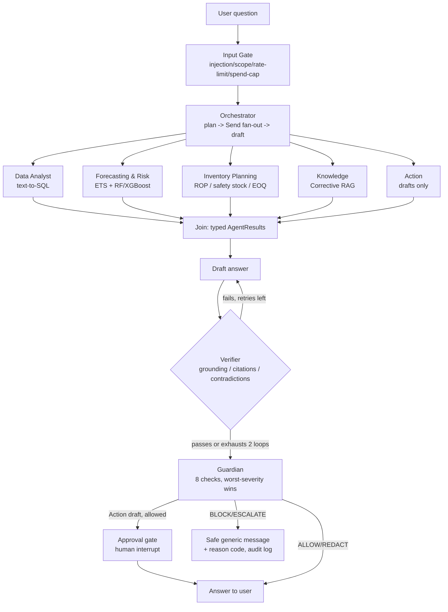

# Vendor Intelligence Copilot

An evaluated AI analytics system on real commercial data: an agentic decision-support copilot
for a beverage distributor's category, procurement and finance teams, built over a 10-day sprint
on top of the [Beverage Distribution vendor analytics
project](https://github.com/hardeep282/Commercial-Analytics---Beverage-Distribution-Project---Vendor-and-Stock-Analysis)
(SQL medallion architecture, forecasting, ML, Power BI).

**Live link:** not yet deployed — AWS/domain provisioning (Day 2 scope) is still pending on my
side; see [Status and honest limitations](#status-and-honest-limitations). Everything below is
built, tested and runnable locally (`uv run uvicorn copilot.api.main:app`).

Built by [Hardeep Bamrah](https://github.com/hardeep282) — MSc Business Analytics (Bournemouth,
2024), 10+ years commercial/B2B background, moving into AI analytics consulting. The point of
this project isn't the demo; it's proving I can build, evaluate, secure and ship a real
multi-agent system, and explain every decision in it.

---

## The problem

*"Which vendors are leaking controllable margin, why, what will next quarter's demand look like
for their top SKUs, and what should I renegotiate?"* — a category manager needs figures pulled
from a 12.8M-row SQL medallion, forecasts, risk scores and contract context stitched together,
without ever getting a hallucinated number or a leaked confidential field. One agent answering
that directly, unverified, is a liability in a commercial setting. This copilot's answer: Python
computes every number, five specialist agents gather evidence in their own lanes, a Verifier
checks the draft is actually grounded in what the specialists found, and a Guardian is the one
mandatory gate every answer passes through before the user sees it — the architecture is the
guardrail.

## Architecture

Every edge to `END` in the compiled LangGraph passes through the Guardian node — enforced by a
topology test (`test_every_path_to_end_passes_through_guardian`) that asserts it against the
*compiled* graph's own edges, not against the Python source that built it.

**Data layer:** the SQL medallion's Gold views are exported to a licence-safe, aggregate-only
DuckDB/Parquet snapshot (never SKU-level, never committed to Git — `docs/adr/002`). A
`policies/disclosure.yaml` tags every table/column Public / Internal / Confidential / Restricted;
enforced three times independently (data layer, SQL validator, Guardian), so no single failure
leaks data.

**Text-to-SQL safety:** a 6-layer `sqlglot` validator (structure → role/k-threshold → semantic
rules → data-coverage → self-correction, max 2 retries → abstain) in
`docs/specs/text_to_sql_safety.md`, red-teamed with an 8-case SQL attack suite plus 15 broader
privacy-leakage cases (23/23 passing, `tests/test_privacy_leakage_suite.py`).

## Agent roster

| Agent | Job | Tools | Model/effort |
|---|---|---|---|
| **Orchestrator** | Plans, fans out to specialists in parallel (`Send`), merges, drafts, loops the Verifier (max 2) | Calls specialists only | Frontier, structured output |
| **Data Analyst** | Text-to-SQL against the licence-safe snapshot | `TextToSqlService` (6-layer validator) | Frontier |
| **Forecasting & Risk** | ETS vs. naive backtest with WAPE/MASE/bias; Random Forest / XGBoost SKU risk classifier with SHAP | `copilot.ml.forecast`, `copilot.ml.risk_classifier` | Deterministic tools, LLM narrates only |
| **Inventory Planning** | Safety stock, reorder point, EOQ from the forecast's own variability | `copilot.ml.inventory` | Deterministic tools |
| **Knowledge** | Corrective RAG over methodology docs + synthetic vendor contracts | Hybrid BM25+vector+RRF, permission-filtered Chroma | Frontier, grader + rewrite loop |
| **Action** | Drafts renegotiation emails / reorder recommendations only | — | Frontier, behind a human-approval interrupt |
| **Verifier** (gate) | Numeric grounding, citations, contradictions; max 2 redraft loops, else finalizes flagged `verified=False` | Read-only on agent results | Frontier |
| **Guardian** (gate) | 8 checks cheapest-first (canary leak, restricted-name leak, raw-row-shape, role policy, vendor-audience, secrets, PII, grounding); worst-severity wins; ALLOW/REDACT/BLOCK/ESCALATE with reason codes to an audit log | Deterministic + Presidio | No LLM judge (by design — see Limitations) |

A sixth agent, a **Model Selection Agent** (propose → critique → revise data-science model
choices with a critic checking assumptions per model family), was added beyond the base sprint
scope (`docs/decisions` Addendum A1) and is built and unit-tested; its real per-scenario eval
numbers are one of the real-key runs still pending (see below).

## Results

All figures are either real runs in this environment or explicitly marked as still pending a
real API key/your machine — nothing below is invented. Full detail: `docs/PROJECT_PROGRESS.md`.

| Area | Result |
|---|---|
| Test suite | **511 passed, 0 failed** (`uv run pytest -q`), ruff/mypy clean |
| Real SQL Server snapshot | 126 vendors, $451.62M revenue (all rows) / $450.9M (cleaned base), spot-checked against two canonical figures (DIAGEO $68,739,834.97 revenue; Martignetti 31.98% blended margin) |
| Golden evaluation set | 46 questions (27 dev / 16 test / 3 adversarial); golden v2 adds 6 text-to-SQL trap questions (semantic traps, coverage gaps) |
| SQL validator | 29/29 unit tests, 0 false positives across 33 real golden queries; catches AVG-over-margin, fan-out joins, cross-vendor count additions, unbounded cross joins (DoS) |
| Privacy-leakage red team | **23/23 passing** (15 leakage cases + 8 SQL attack cases) |
| RAG retrieval (real `all-MiniLM-L6-v2` run) | recall@5 = **0.800**, MRR = **0.662** over 20 labelled questions; 4 misses all traced to one root cause (near-identical boilerplate across same-clause-type contract chunks) |
| Permission-filtered retrieval | filter runs inside the ANN query itself (proven via a small-candidate-pool test), not post-hoc |
| SKU risk classifier, synthetic fixture (leakage story) | RF 0.834→0.820 acc / 0.291→0.211 F1, XGBoost 0.898→0.886 acc / 0.667→0.596 F1 (leaky → leakage-safe) — confirms the direction of the leak |
| SKU risk classifier, real `vw_PortfolioHealth` (n=10,495) | RF 0.997→0.952 acc / 0.994→0.919 F1, XGBoost 0.999→0.971 acc / 0.999→0.953 F1 (leaky → leakage-safe); top SHAP driver after the fix: `StockTurnover` (0.2809) |
| Forecast tool, real portfolio backtest | ETS WAPE 0.1153 ≈ naive WAPE 0.1153 (AutoETS's trend reduces to ~none on this series — naive wins the tiebreak honestly, matches the analytics repo's own 11.8% baseline) |
| Tokenization lab (provider vs. local tokenizers) | provider avg 1889.2 tok; tiktoken underestimates cost by 41.5%, HF `gpt2` by 32.6% — using a local tokenizer alone would misbudget real spend by a third to over 40% |
| Effort lab (`effort` sweep, this model generation has no `temperature` param — see `docs/adr/005`) | 2 real runs, $0.114 / $0.119, exec_acc 0.67 both times; found and fixed a real scoring bug (column-alias mismatch), not a model problem |
| QLoRA fine-tune, text-to-SQL (**benchmarked, not deployed**) | n=60 held-out: QLoRA 1.0 execution accuracy / 1.0 executable rate vs. base zero-shot 0.017/0.25 and base few-shot 0.1/0.333, **no latency penalty** (4.424s vs. 6.764s/3.828s) — see Limitations for the scope of this claim |
| MCP server | Vendor Analytics tools exposed read-only via MCP, exercised against the real snapshot (sprint's "never cut" item) |
| CI eval gate | deterministic layer PASS in every environment; `llm_judged` layer correctly SKIPs without a key rather than fabricating a pass; verified to also fail (exit 1) on an injected regression |

**Cost per query:** one real end-to-end `InsightService` call cost **$0.01127** (7.31s, 1
attempt). The fine-tuning benchmark's 180 held-out generations cost under $1 total. Every
deterministic layer (Guardian, input gate, SQL validator, trace masking, the 511-test suite)
costs $0 — no LLM call in any of it. Full multi-agent per-question cost (Orchestrator +
specialists + Verifier, real numbers) is one of the real-key runs still pending.

**Latency:** p50/p95 per LangGraph node are instrumented (TTFT, total latency, tokens, cost
logged on every `LLMClient` call) but the end-to-end multi-agent p50/p95 table needs a real-key
run of `scripts/run_orchestrator_golden.py` — not yet executed for real, see below.

## Decisions (ADR index)

| ADR | Decision |
|---|---|
| [000](docs/adr/000-corrections-to-master-prompt.md) | Corrections to the master prompt (XGBoost never built pre-sprint; other factual fixes) |
| [001](docs/adr/001-repo-strategy.md) | Separate repository, linked from the analytics repo |
| [002](docs/adr/002-licence-safe-snapshot.md) | Licence-safe snapshot: vendor-level aggregates only, never committed |
| [003](docs/adr/003-runtime-ec2-compose.md) | One EC2 host running Docker Compose behind host nginx |
| [004](docs/adr/004-secrets-and-ci-auth.md) | Secrets in SSM, per-environment keys, OIDC for CI |
| [005](docs/adr/005-llm-provider.md) | Direct Anthropic API, not Bedrock (for now) — and why this model generation has no `temperature` param |
| [006](docs/adr/006-guardian-design.md) | Guardian design: outcome severity ordering, escalation behaviour, audience scope, detection posture |
| [007](docs/adr/007-finetuning-outcome.md) | Fine-tuning outcome: **adopt, conditionally** — validate against a broader question set before replacing the frontier-API call in production |

Full trade-off log (every change re-measured against the golden set, before/after): `docs/TRADEOFF_LOG.md`.

## Status and honest limitations

This is a 10-day **thin vertical slice** — every layer of the architecture is real and tested,
at minimum-viable depth. What's explicitly not done yet, by design (nothing here is hidden):

- **Not deployed.** No live URL. AWS account, domain and GitHub Actions deploy variables are
  still pending on my side — the app runs and is fully tested locally
  (`uv run uvicorn copilot.api.main:app`).
- **QLoRA fine-tune is benchmarked, not deployed.** ADR-007 adopts it *conditionally*: the 1.0
  accuracy is proven only within `sql_pairs_v2`'s fixed question-template family, not general
  text-to-SQL accuracy (`docs/RAID.md` R13). It has not replaced the frontier-API call in
  `TextToSqlService`'s production path, and the repo makes no claim that it has.
- **Postgres checkpointer is unit-tested, not proven live.** No Docker daemon was available in
  the build environment; the branch-selection logic and a two-SQLite-file priority test pass,
  but a real round-trip against a live Postgres hasn't happened yet.
- **Several real-key runs are built and tested but not yet executed for real numbers:**
  `scripts/run_orchestrator_golden.py` (10 multi-hop questions end to end), the CI eval gate's
  `llm_judged` layer, `scripts/run_model_selection_eval.py`, and a full multi-agent p50/p95
  latency table. All of them run against real services with real tests behind them — they just
  need an `ANTHROPIC_API_KEY` and, for some, a GPU/browser session I run locally rather than in
  this build environment.
- **Guardian's semantic layer is deterministic only** — the injection *classifier* named in the
  sprint plan was cut-first; least-privilege tools and the deterministic heuristic checks are
  the real backstop today.
- **12 months of demand history** means seasonality can't be validated; forecast claims are
  scoped to rolling-origin backtests, never a seasonal-fit number presented as accuracy.
- **A 0.1% revenue gap** between two source tables (`docs/RAID.md` R6) is open and unresolved;
  agents are built not to mix the two sources in one answer without saying so.

Full risk register: `docs/RAID.md`. Full day-by-day build history, including every bug found and
fixed before a number was trusted: `docs/BUILD_LOG.md`.

## Roadmap (depth track, after this sprint)

Same repo, same agent contracts, no rewrites — re-prioritised toward evaluation depth and the
Model Selection Agent first (not infrastructure), per Addendum A1 §3: RAGAS + LLM-as-judge
calibration, the Model Selection Agent's real eval numbers, XGBoost-vs-RF depth, advanced RAG
(Contextual Retrieval, GraphRAG experiment), LangGraph agent-design depth, production-essentials
depth (IaC, staging, backups drill, SLOs), remote MCP with OAuth, then the deferred deep-learning
builds (PyTorch/transformer from scratch, DPO, vLLM). Full order: `docs/decisions` Addendum A1 §3
and the sprint plan's X1 section.

## Tech stack

Python 3.12, `uv`, FastAPI, LangChain/LangGraph 1.2, Anthropic API, LangSmith, DuckDB/Parquet,
Chroma + `sentence-transformers` (hybrid BM25+vector+RRF retrieval), scikit-learn + XGBoost +
SHAP, statsforecast, Presidio, `sqlglot`, Docker/EC2/Nginx/Certbot (target runtime), GitHub
Actions, Model Context Protocol. Full map of every file: `docs/CODE_MAP.md`.
